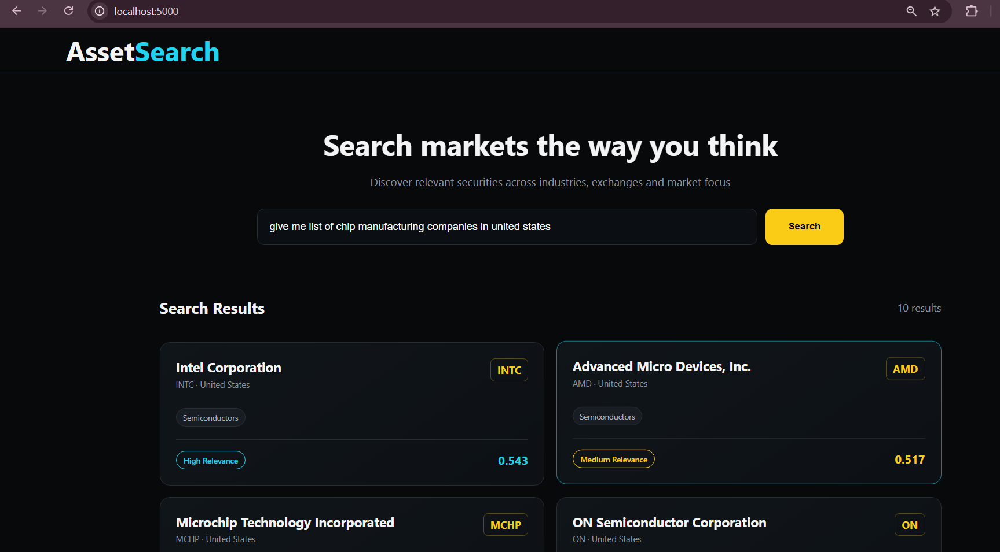

# AssetSearch

AssetSearch is an Elasticsearch based intelligent search service to discover portfolio securities through natural language queries.

## Steps

- Fetches S&P 500 companies data from Yahoo Finance(yfinance SDK)
- Splits long company descriptions into chunks and generates vector embeddings using Sentence Transformer
- Stores metadata and embeddings in Elasticsearch
- Uses Ollama to extract filters such as name, country, exchange and industry from user query
- Combines lexical search, semantic search and structured filters to get relevant securities
- Provides a Flask/Jinja web interface for natural-language search

## Tech Stack

Python, Elasticsearch, Sentence Transformers, Ollama, yfinance, Flask, Jinja2

## Example

### Query
```text
give me list of chip manufacturing companies in united states
```

### Response

